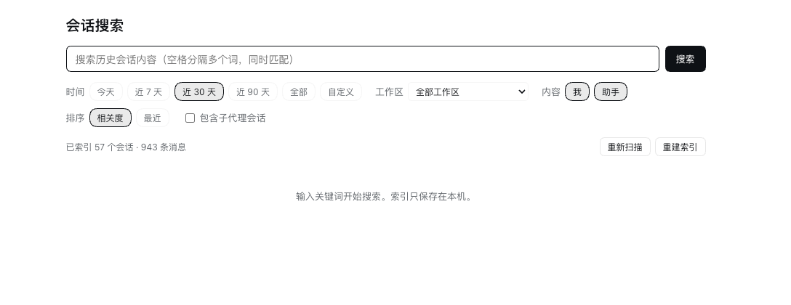

# dsh-session-fts

DeepSeek Harness（DSH）的本地分层会话搜索插件：标题、中文全文和多语言语义搜索，共用时间范围与工作区筛选。

本仓库基于 [xuhuaiqu/dsh-session-fts](https://github.com/xuhuaiqu/dsh-session-fts) 的 MIT 版本维护扩展，保留上游署名与许可证。安装本 fork 的版本化发布物，见 [分层搜索说明](docs/LAYERED-SEARCH.md)；上游安装命令只安装原版全文功能。

Local full-text search over earlier DeepSeek Harness sessions, with reliable Chinese matching, time-range filters, a sidebar search page, and an agent tool. [English summary](#english).



## 为什么需要它

DSH 内置的会话搜索后端用的是 SQLite FTS5 的 `unicode61` 分词器，它把一段不带空格的中文当成一个词，所以句子中间的中文词基本搜不到。在同一批文档上对比内置索引和本插件的逐字分词方案：

| 关键词 | 子串实际出现 | 内置索引命中 | 逐字分词命中 |
|---|---|---|---|
| 全文搜索 | 11 | 0 | 11 |
| 搜索 | 147 | 40 | 147 |
| 插件 | 161 | 62 | 161 |

这批文档包含工具输出。本插件默认不索引工具输出，所以默认配置下实际命中数会更少，但仍然与子串扫描一致。设计细节和更多实测见 [技术方案](docs/DESIGN.md)。

内置搜索默认关闭，侧栏界面上也没有时间范围选项。

## 功能

- **本地检索。** 全文索引默认在 `~/.dsh/session-fts.sqlite`，语义向量在相邻的 `.semantic.sqlite` 文件。模型首次使用时下载到本地缓存，推理及检索在本机执行，不上传会话原文。索引只从会话日志派生，插件不会写会话日志。
- **分层搜索。** 标题只查询会话元数据；全文使用中文逐字 FTS5 索引；语义使用 multilingual-e5-small 量化模型和 sqlite-vec。语义尚未就绪或失败时，标题与全文仍可使用。
- **中文可用。** 入库前给每个中日韩字符两边加空格，让它成为单独的词元；查询编译成连续字符的短语，所以命中结果和字面子串一致。英文按单词匹配，结尾是字母或数字时也匹配前缀（`sqlite` 能找到 `sqlite3`）。
- **时间范围。** 今天、近 7 / 30 / 90 天、全部、自定义起止日期，默认近 30 天。
- **筛选和排序。** 工作区、发言方（我 / 助手 / 工具输出）、是否包含子代理会话；可按相关度（bm25）或时间排序。
- **搜索页面。** 左侧栏“会话搜索”入口。结果按会话分组，每组最多 3 条带高亮和时间的片段，点击打开会话。
- **智能体工具 `session_fts_search`。** 默认只搜当前工作区，不包含当前会话；`scope: "all"` 搜全部工作区。
- **增量更新。** 启动后对比每个会话的持久化 revision，只读取有变化的会话；会话是只追加的，所以只补新事件。运行中的会话新增消息后约 1.5 秒进入索引。

## 索引什么

| 内容 | 是否索引 |
|---|---|
| 你输入的消息 | 是 |
| 助手的回复文本 | 是 |
| 自动注入的上下文（技能目录、运行时上下文、时间戳、工作区说明等） | 否 |
| 推理过程 | 否 |
| 工具调用与结果 | 默认否，`indexToolOutput: true` 时开启 |

## 安装

需要 DeepSeek Harness 0.2.2 或更新版本（运行时自带 `node:sqlite`，不需要安装任何依赖）。

从 npm 安装（Desktop 用户把 `web` 换成 `desktop`）：

```bash
dsh plugin --profile web add dsh-session-fts
```

也可以在 DSH 的 **插件 → 添加插件** 中输入 `dsh-session-fts`。

从 GitHub 源码安装：

```bash
dsh plugin --profile web add github:xuhuaiqu/dsh-session-fts
```

或者从本地目录安装：

1. 克隆本仓库到本地。
2. 在 DSH 中打开 **插件 → 添加插件**，选择本地目录安装并启用。

安装后打开左侧栏的 **会话搜索**。首次建索引在启动约 3 秒后开始，几十个会话通常不到 1 秒。

可选：内置的 `session-query-sqlite` 索引和本插件互相独立。如果之前在 profile 里打开过内置索引，可以在 `cordis.patch.yml` 里把它改回关闭，避免保存两份索引：

```yaml
- id: session-query-sqlite
  name: "@deepseek-ai/dsh-session-query-sqlite"
  config:
    path: ':memory:'
    openAt: never
```

## 配置

在 profile 的 `cordis.patch.yml` 中用相同 id 覆盖。覆盖会整段替换 `config`，保留的字段要一起写上。

```yaml
- id: session-fts
  name: 'dsh-session-fts'
  config:
    indexToolOutput: false
    defaultDays: 30
    maxResults: 20
    maxDocChars: 20000
    includeSubagents: false
```

| 字段 | 默认值 | 含义 |
|---|---|---|
| `path` | `~/.dsh/session-fts.sqlite` | 索引文件的绝对路径 |
| `indexToolOutput` | `false` | 是否索引工具调用和结果（体积更大、结果更杂） |
| `defaultDays` | `30` | 智能体工具没给日期时搜索的天数，`0` 为全部 |
| `maxResults` | `20` | 每页会话数 |
| `maxDocChars` | `20000` | 每条消息最多索引的字符数 |
| `includeSubagents` | `false` | 默认是否包含子代理会话 |
| `liveDelayMs` | `1500` | 新消息合并写入索引前的等待时间 |
| `startupDelayMs` | `3000` | 启动后多久开始首次建索引 |

修改 `indexToolOutput` 或 `maxDocChars` 后索引会自动重建。

## 智能体工具

`session_fts_search` 的参数：

| 参数 | 说明 |
|---|---|
| `query` | 必填。空格分隔的多个词需要同时出现 |
| `days` | 最近 N 天，`0` 为全部；给了 `from` 时忽略 |
| `from` / `to` | `YYYY-MM-DD`（本地时间，`to` 包含当天）或 ISO 时间 |
| `scope` | `workspace`（默认）或 `all` |
| `roles` | `user` / `assistant` / `tool` 的子集 |
| `sort` | `relevance`（默认）或 `recent` |
| `limit` / `offset` | 分页，`limit` 为 1–50 |

返回纯文本：每个会话的标题、`session_id`、工作区、命中数，以及带角色、`seq` 和时间的片段。

## HTTP 接口

搜索页面通过同源路由调用 Host，复用 DSH 的连接鉴权（`ctx.connection.requestRejection`），未登录的请求会被拒绝。

| 方法 | 路径 | 说明 |
|---|---|---|
| `POST` | `/session-fts/api/search` | 请求体同工具参数，另有 `cwd`、`includeSubagents` |
| `GET` | `/session-fts/api/status` | 索引统计、建索引进度、工作区列表 |
| `POST` | `/session-fts/api/reindex` | 重新扫描；`{"full": true}` 为清空后重建 |

`/session-fts/api/` 是相对页面地址解析的，所以 Desktop 和反向代理子路径下都能访问。

## 实现

| 文件 | 职责 |
|---|---|
| [`index.js`](index.js) | 插件入口：配置、智能体工具、HTTP 路由 |
| [`host/indexer.js`](host/indexer.js) | 与会话语料对账、增量更新、串行任务队列 |
| [`host/store.js`](host/store.js) | SQLite 表结构、写入事务、查询与按会话分组 |
| [`host/text.js`](host/text.js) | 文本抽取、中日韩分字、查询编译、片段截取 |
| [`client.js`](client.js) | Web 端：侧栏入口与搜索页面（React，无构建步骤） |

数据表：`sessions`（每个会话一行，含索引标记）、`events`（每条可搜索消息一行）、`fts`（contentless FTS5 表，rowid 对应 `events.id`）。用户输入的查询词会被包成带引号的 FTS5 短语，`OR`、`NEAR`、`*` 等语法都按普通文字处理。

完整设计（分词方案对比、存储结构、增量对账、查询、接口、性能、安全）见 [docs/DESIGN.md](docs/DESIGN.md)。

## 限制

- 点击会话标题打开会话，点击命中片段按精确事件 seq 定位；冷历史最多补载 40 页、120 秒，超时、目标已删或当前不是聊天视图时显示明确提示。
- SQLite 同步调用在专属 worker 执行，Host 不执行查询或索引写入；取消进行中的同步语句会丢弃结果，语句本身结束前仍占用 worker 队列槽。
- 同机多个 DSH 进程可以共享本地磁盘上的同一完整语料索引；必须使用一致的 sourceId 与提取配置。语义刷新通过跨进程租约协调，模型身份冲突明确拒绝。跨设备通过服务接口同步，不能把 SQLite 放到 SMB/NFS 上共享。

<a id="english"></a>
## English

A DeepSeek Harness plugin that keeps a local SQLite FTS5 index of earlier sessions. Every CJK character is indexed as its own token and queries compile to consecutive-character phrases, so Chinese text matches exactly where the literal substring occurs, which the built-in `unicode61` index cannot do. It adds a **Session search** page to the left sidebar (time range presets with a 30-day default, custom dates, workspace, author, and subagent filters, relevance or recency order) and a `session_fts_search` agent tool scoped to the current workspace by default. Only text the person typed and assistant replies are indexed; injected context and reasoning are skipped, and tool output is opt-in through `indexToolOutput`. Install it in DSH 0.2.2 or later with `dsh plugin --profile web add dsh-session-fts` (npm), `dsh plugin --profile web add github:xuhuaiqu/dsh-session-fts` (source), or add a cloned directory under **Plugins → Add plugin**. No dependencies, no network access. Design notes (in Chinese): [docs/DESIGN.md](docs/DESIGN.md).

## License

[MIT](LICENSE)
