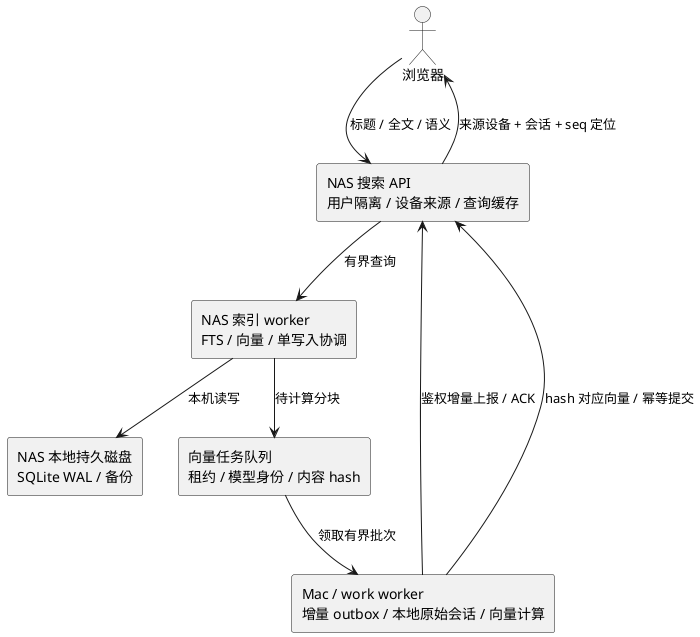

# NAS 中控与 worker 搜索部署方案（待审核）

## 当前可核实的基础

本仓库已实现本机标题、全文与本地模型语义搜索。SQLite worker 与命中 seq 定位正在本轮集成；同机多进程共享只适用于同一完整 Session 语料、相同提取配置和本地磁盘。它不意味着不同设备可以共用网络挂载的 SQLite 文件。

本机另有 `dsh-session-memory` 的中央服务源码（`service/central-node.mjs`）和 `/v1/ingest`、`/v1/search` 协议：令牌绑定用户及设备，幂等收录最终消息，中文 FTS 已有测试。它当前以 turnIndex 标识消息、缺少精确事件 seq、向量任务与删除水位，不能直接冒充本插件的完整分布式后端。源码存在不代表 NAS 当前部署及可用状态已核验。fleet 有独立任务领取与租约能力，用于执行协调，搜索内容及向量数据不放进任务提示或执行日志。

## 建议的部署分工

NAS 保持统一搜索 API、鉴权、索引写入和持久备份。Mac 等 worker 保留原始 Session 日志，只增量上报可搜索消息和来源标识，承担批量文档向量生成；NAS 保持轻量常驻查询模型或使用查询向量缓存，避免每次检索等一台可能休眠的 Mac。在线 worker 只影响新向量补齐，标题及全文不依赖向量 worker 在线。

## 必须保持的同步语义

消息主键包含 `userId/deviceId/profile/sessionId/seq`，避免不同设备的相同 sessionId 覆盖。用户与设备身份从服务端令牌解析，不能相信请求体。工作区增加可选 projectId 关联，同名目录不自动视为同项目。正文只上传用户消息及助手回复，工具输出明确选择加入；记忆注入和推理内容沿用当前排除规则。

worker 的持久 outbox 记录消息、标题更新和删除 tombstone。NAS 事务提交后返回 ACK，worker 才推进水位；断网、重复发送、进程重启均可安全重试。用 source generation 区分会话重建，清理只能由所属设备提交的完整清单或明确 tombstone 触发，NAS 不根据一次不完整列表删除其他设备数据。

向量任务以模型版本、dtype、pooling、归一化、分块配置与内容 hash 共同确定身份。租约带 epoch；过期任务或旧模型结果在提交时拒绝，不能靠 worker 自报成功。正文更新和删除后，旧 hash 的向量立即不参与搜索。索引持久保存任务状态，worker 休眠或被终止后可重新领取。查询向量缓存按模型身份和文本分键，结果缓存按用户、筛选与索引 revision 分键，均设置条目与字节预算。

结果带设备、profile、sessionId、seq 和受控 origin。打开同机命中使用当前公开 Session API 定位；打开远端命中使用已登记设备 URL 的深链接，到源设备登录后再定位，不把私有会话自动导入当前设备，也不接受正文中任意 URL 作为导航目标。源设备离线时仍能展示索引片段和离线状态，不能声称打开成功。

## 性能与故障处理

所有 SQLite 工作留在 NAS 专属 worker；Host 只做鉴权和有界传输。读连接使用 WAL，写入批量短事务；绝不通过 SMB/NFS/Tailnet 文件挂载共享数据库。NAS 与 Mac 之间传增量和模型结果，不复制整个索引。outbox、批次大小、网络并发和最大排队字节有界；超过预算显示滞后，不无限累积内存。

部署初期继续使用现有 SQLite/FTS 和 sqlite-vec，先测真实增长曲线；sqlite-vec 是精确扫描，不因 worker 化就变为 ANN。只有在目标语料上出现持续无法达到查询预算的证据时，再评估社区向量服务。多用户检索必须先过滤授权范围再 top-k，不能先全库近邻后丢弃不属于该用户的结果。

NAS 故障时设备本地搜索继续工作，界面标明全局索引不可用与最后同步时间；重连从 ACK 水位补发。备份通过 SQLite backup 或停写快照生成，不能只复制忽略 WAL 的主文件。回滚先关闭新增同步入口，再恢复固定旧插件版本，保留本地 Session、outbox 和中央数据库备份。

## 远端变更审核单

建议首先在 NAS 建独立候选搜索服务与新数据目录，不覆盖现有记忆库或搜索库；只接入一个 Mac 测试来源，验证鉴权、隔离、重复提交、删除、断网补发、旧模型拒绝和跨设备消息定位。通过后才将统一搜索入口切到 NAS，再逐台增加 worker。正式切换前记录现有服务、profile、端口、数据目录、资源用量与回滚命令。

本轮不修改 NAS、work、home 的服务、配置或数据。待本地实现和部署清单可审查后，单独请求批准 NAS 候选部署；未收到明确批准前不远端写入。现有中央服务与 fleet 先做只读部署核查，再决定扩展原协议还是增加独立版本，不先建第三套长期索引。
